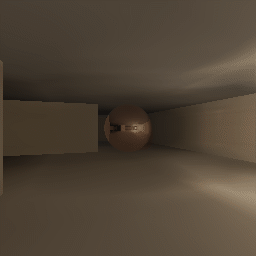
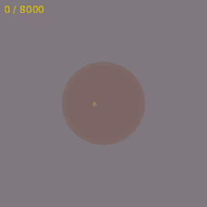

# Multiscale-Hashgrid-demo-enviroment





```sh
make play
```

Requires C++17, CMake, SDL2, and OpenGL 3.3. [Training tooling](training/README.md).
The hashgrid learns lighting; geometry is fixed.
